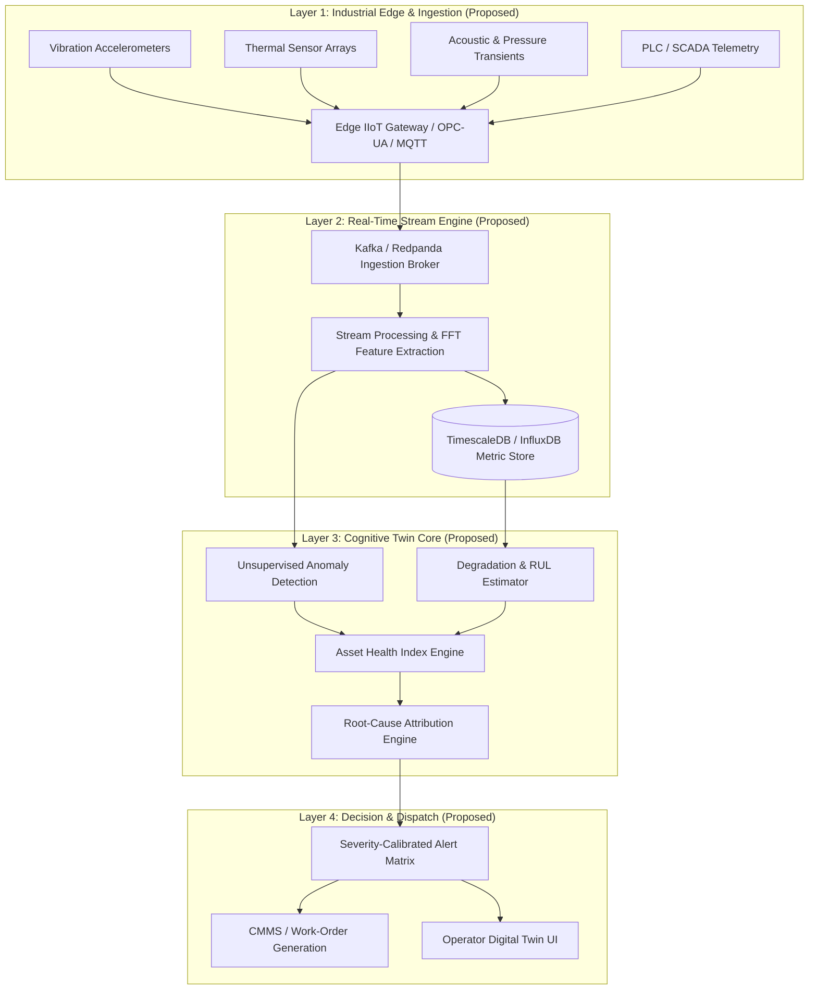

# FactoryMind-CDT: Cognitive Digital Twin Architectural Specification

[](https://github.com/Mohamed-Osama-ai7/FactoryMind-CDT)
[](https://github.com/Mohamed-Osama-ai7/FactoryMind-CDT)
[](https://github.com/Mohamed-Osama-ai7/FactoryMind-CDT)
[](FactoryMind_CDT_Project_Documentation_with_UI_UX.pdf)

An industrial artificial intelligence architecture and engineering design initiative. **FactoryMind-CDT** formalizes a closed-loop **Cognitive Digital Twin (CDT)** framework designed to bridge high-frequency IIoT sensor telemetry with predictive asset health assessment and prescriptive operational reasoning in high-throughput manufacturing plants.

---

> **Engineering Status Notice**:  
> FactoryMind-CDT is currently maintained as an **architectural specification, mathematical formulation, and conceptual system design**. All functional components, mathematical formulations, and system topologies described below represent the target engineering architecture documented in [`FactoryMind_CDT_Project_Documentation.pdf`](FactoryMind_CDT_Project_Documentation_with_UI_UX.pdf). This repository does not currently contain deployed microservices, production edge runtimes, or live database instances.

---

## 🏭 Operational Paradigm

Modern industrial machinery operates under complex, non-linear thermal, mechanical, and dynamic loads. Traditional condition monitoring relies on static thresholding that causes severe alert fatigue and misses subtle multi-sensor degradation signatures.

FactoryMind-CDT conceptualizes a 5-stage closed-loop operational paradigm:

```
  ┌───────────┐      ┌──────────────┐      ┌────────────┐      ┌───────────┐      ┌───────────┐
  │   SENSE   │ ───► │  UNDERSTAND  │ ───► │  SIMULATE  │ ───► │  DECIDE   │ ───► │   LEARN   │
  └───────────┘      └──────────────┘      └────────────┘      └───────────┘      └───────────┘
   Multi-sensor       Anomaly Scoring       Degradation          Prescriptive      Closed-Loop
    Telemetry           & Signatures         & RUL Curve         Intervention       Feedback
```

1. **SENSE (Edge Ingestion & Signal Conditioning)**: Specification for multi-modal telemetry acquisition (vibration accelerometry, thermal transients, acoustic emissions, pressure profiles) with edge-side digital signal processing (DSP) filtering.
2. **UNDERSTAND (Feature Extraction & Anomaly Isolation)**: Proposed spectral FFT decomposition and unsupervised anomaly scoring (Isolation Forests / Autoencoder reconstruction error) to detect micro-faults prior to critical threshold breaches.
3. **SIMULATE (Degradation & RUL Trajectories)**: Proposed physics-informed wear modeling coupled with Weibull hazard rate estimation to simulate Remaining Useful Life (RUL) under variable production loads.
4. **DECIDE (Prescriptive Action & Attribution)**: Proposed dispatch matrix calibrated against ISO 10816 vibration severity standards, routing automated maintenance recommendations with root-cause attribution.
5. **LEARN (Closed-Loop Model Adaptation)**: Proposed feedback protocol incorporating post-maintenance service outcomes and component teardown telemetry to dynamically re-calibrate baseline health thresholds.

---

## 🏛️ Target System Architecture

The target architecture defines a decoupled four-layer industrial intelligence topology:



---

## 📋 Architectural Specifications & Implementation Status

To ensure full transparency between conceptual system design and code implementation, component readiness is explicitly categorized below:

| System Component | Architectural Specification | Implementation Status | Artifact / Verification |
| :--- | :--- | :---: | :--- |
| **System Blueprint** | Full 5-stage closed-loop cognitive twin architecture | **Documented** | [`FactoryMind_CDT_Project_Documentation.pdf`](FactoryMind_CDT_Project_Documentation_with_UI_UX.pdf) |
| **Mathematical Models** | Spectral FFT, Weibull hazard curves, anomaly formulations | **Documented** | Detailed formulas in project PDF |
| **Signal DSP (FFT)** | High-frequency accelerometry filtering & envelope analysis | *Architecture Design* | Planned for Phase 1 Python implementation |
| **Anomaly Scoring** | Isolation Forests & Autoencoder reconstruction error | *Architecture Design* | Planned for Phase 2 ML prototyping |
| **RUL Estimation** | Physics-informed degradation curves & time-to-failure ($T_{fail}$) | *Architecture Design* | Planned for Phase 2 ML prototyping |
| **IIoT Connectors** | OPC-UA (asyncua) & MQTT telemetry ingestion protocols | *Proposed Architecture* | Planned for Phase 3 edge integration |
| **Time-Series Storage** | TimescaleDB / InfluxDB high-throughput metric schemas | *Proposed Architecture* | Planned for Phase 3 database tier |
| **Prescriptive Dispatch**| ISO 10816 calibrated maintenance routing & CMMS hooks | *Proposed Architecture* | Planned for Phase 4 operational tier |
| **Closed-Loop Learning** | Dynamic baseline updating via maintenance outcome telemetry | *Proposed Architecture* | Planned for Phase 4 operational tier |

---

## 📁 Repository Structure

```
FactoryMind-CDT/
├── FactoryMind_CDT_Project_Documentation.pdf   # Master architectural specification & slides (228 KB)
└── README.md                                   # Framework overview & component readiness breakdown
```

> The repository currently serves as the official distribution point for the FactoryMind-CDT architectural specification document. As code implementations transition from design to active prototyping, source directories will be established and validated under version control.

---

## 📖 Reviewing the Architectural Specification

The complete architectural treatise, system block diagrams, mathematical modeling equations, and operational workflows are compiled in the project specification document:

1. **Direct Download**: Download [`FactoryMind_CDT_Project_Documentation.pdf`](FactoryMind_CDT_Project_Documentation_with_UI_UX.pdf) from the repository root.
2. **Key Sections**:
   - Section 1: Executive Overview & Industrial Problem Formulation
   - Section 2: Sensor Telemetry & High-Frequency DSP Specification
   - Section 3: Machine Learning Framework (Anomaly Isolation & RUL Prediction)
   - Section 4: Prescriptive Operational Playbooks & ISO 10816 Threshold Standards
   - Section 5: Future Engineering Roadmap & Implementation Milestones

---

## 🗺️ Engineering Roadmap

- [x] **Milestone 0**: Formalize conceptual architecture, operational dataflows, and mathematical formulations ([Documentation PDF](FactoryMind_CDT_Project_Documentation_with_UI_UX.pdf)).
- [ ] **Milestone 1**: Implement synthetic sensor telemetry generator and prototype NumPy/SciPy FFT feature extraction pipeline.
- [ ] **Milestone 2**: Benchmark baseline anomaly detection algorithms (Isolation Forest vs. Autoencoder) on open industrial bearing datasets (e.g., NASA C-MAPSS / IMS).
- [ ] **Milestone 3**: Design containerized ingestion microservices using OPC-UA / MQTT stubs and TimescaleDB storage schemas.
- [ ] **Milestone 4**: Build Streamlit / Plotly asset health visualization and prescriptive maintenance dispatch interface.

---

## 👤 Author & Research Attribution

Architectural specification and design by **[Mohamed Osama](https://github.com/Mohamed-Osama-ai7)**.  
*Applied AI & Machine Learning Engineering · Cairo, Egypt*
