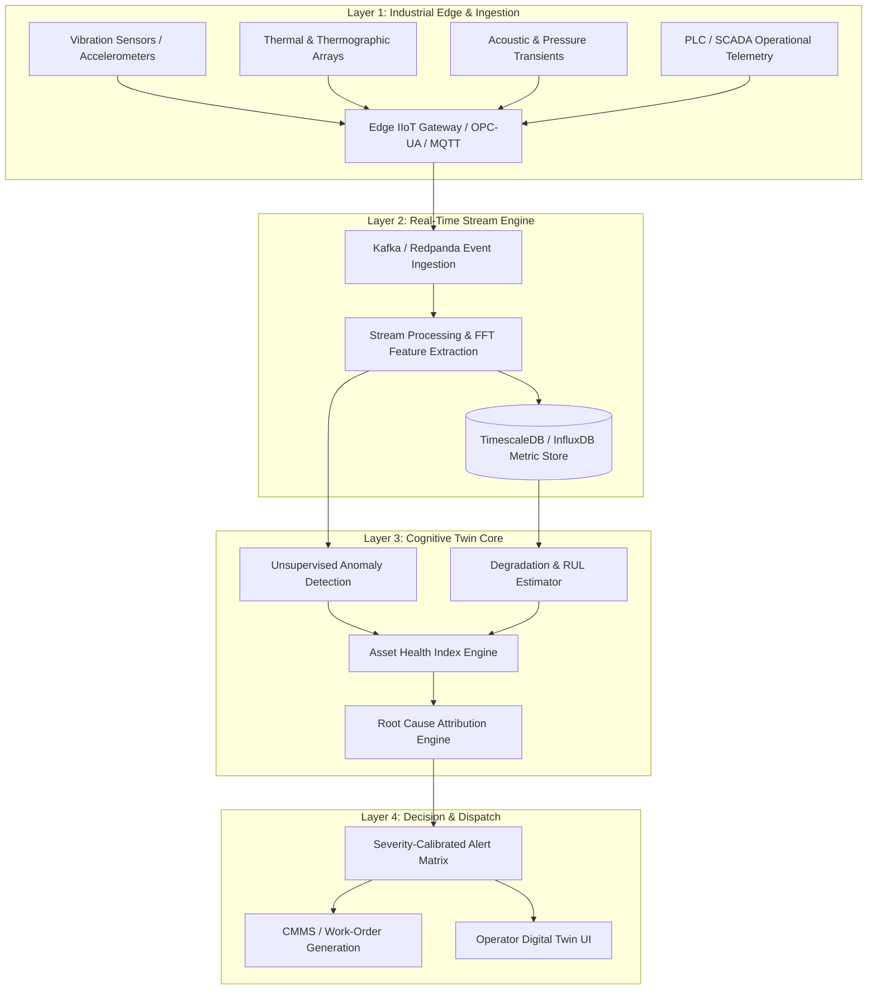

# FactoryMind-CDT: Cognitive Digital Twin for Industrial Decision Intelligence

[](https://www.python.org/)
[](https://github.com/Mohamed-Osama-ai7/FactoryMind-CDT)
[](https://github.com/Mohamed-Osama-ai7/FactoryMind-CDT)
[](https://github.com/Mohamed-Osama-ai7/FactoryMind-CDT)
[](LICENSE)

An enterprise-grade **Cognitive Digital Twin (CDT)** framework designed for continuous industrial asset monitoring, predictive health assessment, and autonomous root-cause reasoning in high-throughput manufacturing operations.

---

## 🏭 Executive Overview

Modern industrial equipment operates under complex, non-linear thermal, mechanical, and dynamic operating loads. Traditional condition monitoring relies on static threshold alerts that either fail to catch subtle degradation patterns or trigger alert fatigue.

**FactoryMind-CDT** bridges high-frequency IIoT telemetry and cognitive intelligence through a 5-stage closed-loop operational paradigm:

```
  ┌───────────┐      ┌──────────────┐      ┌────────────┐      ┌───────────┐      ┌───────────┐
  │   SENSE   │ ───► │  UNDERSTAND  │ ───► │  SIMULATE  │ ───► │  DECIDE   │ ───► │   LEARN   │
  └───────────┘      └──────────────┘      └────────────┘      └───────────┘      └───────────┘
   Multi-sensor       Anomaly Scoring       Degradation          Prescriptive      Closed-Loop
    Telemetry           & Signatures         & RUL Curve         Intervention       Feedback
```

1. **SENSE**: Edge aggregation of multi-modal sensory streams (vibration spectrums, thermal profiles, acoustic emissions, and pressure transients).
2. **UNDERSTAND**: Real-time multi-dimensional state estimation, spectral decomposition, and unsupervised early anomaly detection.
3. **SIMULATE**: Dynamic physics-informed degradation modeling to project Remaining Useful Life (RUL) trajectories under variable operating scenarios.
4. **DECIDE**: Deterministic priority playbooks, prescriptive maintenance dispatching, and root-cause analysis (RCA) with explainable attribution.
5. **LEARN**: Continuous model re-calibration incorporating post-maintenance service outcomes and component teardown telemetry.

---

## 🏛️ System Architecture



---

## ⚙️ Core Technical Capabilities

### 1. Multi-Modal Sensor Fusion & Signal Processing
- High-frequency vibration signal analysis: Fast Fourier Transform (FFT), spectral kurtosis, envelope analysis, and crest factor extraction.
- Thermal profile drift detection and correlation with ambient environmental conditions.
- Noise-robust edge filtering with moving median and exponential smoothing filters.

### 2. State Estimation & Anomaly Detection
- Multivariate anomaly scoring across correlated operating variables (speed, load, temperature, vibration RMS).
- Unsupervised Isolation Forest and Autoencoder reconstruction error pipelines to isolate degradation before critical thermal thresholds.
- Dynamic operating envelope baseline adjustment to prevent false positives during scheduled ramping and load variations.

### 3. Degradation Modeling & Remaining Useful Life (RUL)
- Weibull hazard modeling combined with gradient-boosted regression on degradation curves.
- Multi-scenario asset wear simulation based on projected production schedules and ambient stress factors.
- Confidence intervals for estimated time-to-failure ($T_{fail}$) aiding precision parts procurement.

### 4. Prescriptive Action & Root-Cause Attribution
- Feature attribution mapping anomalous sensor contributions to physical subsystems (e.g., inner race bearing wear, impeller cavitation, shaft misalignment).
- Deterministic P1–P4 action dispatch matrices aligned with ISO 10816 vibration severity standards.

---

## 🛠️ Technology Stack

| Domain | Technology / Library |
| :--- | :--- |
| **Core Logic & ML** | Python 3.10+, PyTorch, scikit-learn, SciPy, NumPy |
| **Feature Extraction** | FFT, Wavelet transforms, Pandas, Librosa |
| **Industrial Ingestion** | OPC-UA (asyncua), MQTT (paho-mqtt), Kafka |
| **Time-Series Storage** | TimescaleDB, InfluxDB, PostgreSQL |
| **Serving & Orchestration** | FastAPI, Docker, Pydantic v2 |
| **Visualization & Monitoring** | Streamlit, Plotly, Grafana |

---

## 📁 Repository Structure

```
FactoryMind-CDT/
├── FactoryMind_CDT_Project_Documentation.pdf   # Architectural specification & slides
├── config/                                     # Sensor threshold and pipeline configs
│   └── sensor_profiles.yaml
├── src/                                        # Core twin framework
│   ├── ingestion/                              # OPC-UA & MQTT stream connectors
│   ├── processing/                             # Signal DSP, FFT, and spectral features
│   ├── models/                                 # Anomaly detection & RUL estimators
│   └── decision/                               # Prescriptive RCA and action playbooks
├── notebooks/                                  # Exploratory signal analytics & validation
├── tests/                                      # Unit and integration test suites
├── Dockerfile                                  # Container runtime specification
└── README.md                                   # Project documentation
```

---

## 🚀 Getting Started

### Prerequisites
- Python 3.10 or higher
- Git

### Installation

```bash
# Clone the repository
git clone https://github.com/Mohamed-Osama-ai7/FactoryMind-CDT.git
cd FactoryMind-CDT

# Create and activate virtual environment
python -m venv venv
source venv/bin/activate  # On Windows: .\venv\Scripts\activate

# Install dependencies
pip install -r requirements.txt
```

---

## 📄 License & Attribution

Developed by **[Mohamed Osama](https://github.com/Mohamed-Osama-ai7)**.  
Released under the [MIT License](LICENSE).
